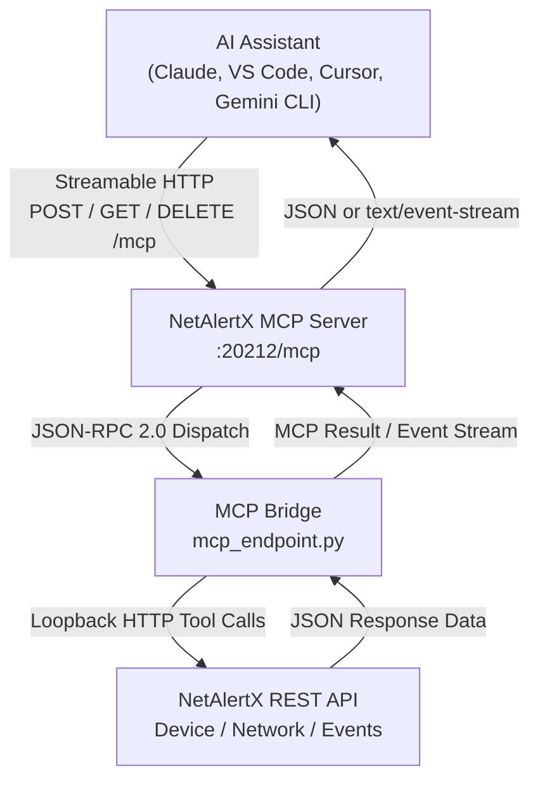
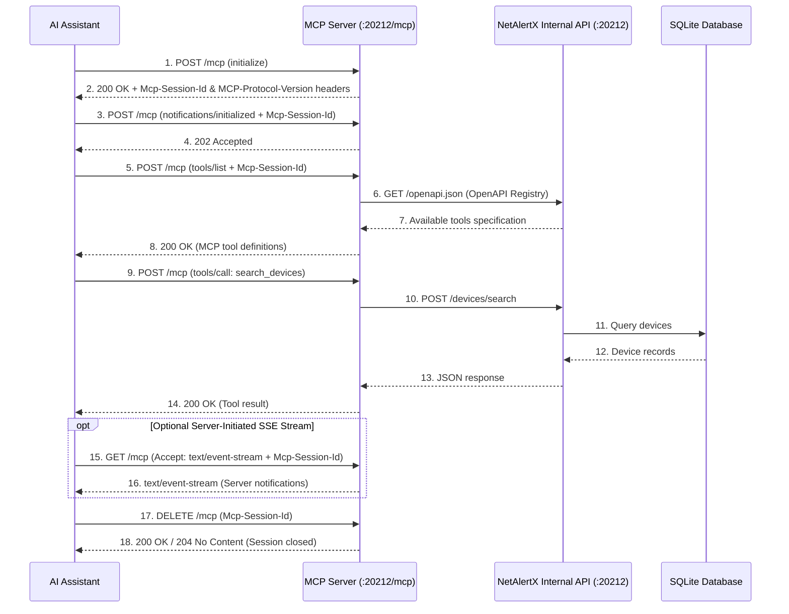
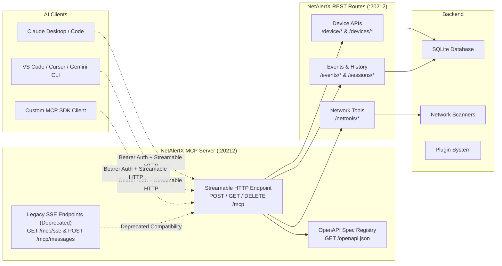

# MCP Server Bridge API

The **MCP (Model Context Protocol) Server Bridge** provides AI assistants with standardized access to NetAlertX functionality through **Streamable HTTP** (`POST /mcp`, `GET /mcp`, `DELETE /mcp`), MCP Tools, Resources, and Prompts. This enables AI systems to query and interact with your network monitoring data in real time.

---

## Overview

The MCP Server Bridge exposes NetAlertX functionality as **MCP Tools**, **Resources**, and **Prompts** that AI assistants can invoke to:

- Search and retrieve device information
- Trigger network discovery and port scans
- Retrieve network topology, events, and session history
- Wake devices via Wake-on-LAN
- Inspect open port information and system logs
- Update device aliases and metadata

All MCP tools dynamically map from the NetAlertX OpenAPI registry (`GET /openapi.json`) and mirror the functionality of standard REST endpoints via JSON-RPC 2.0 calls over `/mcp`.

### Supported Protocol Versions

| Protocol Version | Transport | Status |
|------------------|-----------|--------|
| `2025-06-18` | Streamable HTTP (`/mcp`) | Supported (Current) |
| `2025-03-26` | Streamable HTTP (`/mcp`) | Supported |
| `2024-11-05` | Streamable HTTP (`/mcp`) and Legacy HTTP+SSE (`/mcp/sse`, `/mcp/messages`) | Supported (HTTP+SSE transport is **Deprecated**) |

---

## Architecture Overview

### MCP Connection Flow



### MCP Tool Integration



### Component Architecture



---

## Authentication

All MCP endpoints require **Bearer token authentication** matching your configured `API_TOKEN`:

```http
Authorization: Bearer <API_TOKEN>
```

Unauthorized requests return HTTP `401 Unauthorized` (or `403 Forbidden`):

```json
{
  "success": false,
  "error": "Unauthorized"
}
```

---

## Streamable HTTP Transport (`/mcp`) - Recommended

NetAlertX implements the modern **MCP Streamable HTTP** transport on a single unified endpoint: `/mcp` (also accessible via the reverse-proxy path `/server/mcp`).

### Headers

| Header | Direction | Description |
|--------|-----------|-------------|
| `Authorization` | Request | Required. `Bearer <API_TOKEN>`. |
| `Content-Type` | Request / Response | `application/json` for JSON-RPC POST bodies and responses; `text/event-stream` for SSE streams. |
| `Accept` | Request | Clients should include `application/json, text/event-stream` on `POST /mcp` and `text/event-stream` on `GET /mcp`. |
| `Mcp-Session-Id` | Response & Request | Issued by the server on `initialize` response. Clients pass this header on subsequent `POST`, `GET`, and `DELETE` requests to bind to the active session. |
| `MCP-Protocol-Version` | Request & Response | Negotiated MCP protocol version (for example, `2025-06-18`, `2025-03-26`, or `2024-11-05`). |

### 1. Send JSON-RPC Requests, Notifications, or Batches (`POST /mcp`)

* **POST** `/mcp`

  Accepts a single JSON-RPC 2.0 request, notification, or a JSON array batch of requests/notifications.

  - **`initialize` request**: Creates a new MCP session, negotiates the protocol version (`2025-06-18`, `2025-03-26`, or `2024-11-05`), and returns the session identifier in the `Mcp-Session-Id` response header along with `MCP-Protocol-Version`.
  - **JSON-RPC requests (`tools/list`, `tools/call`, `resources/list`, `resources/read`, `prompts/list`, `prompts/get`, `ping`)**: Returns HTTP `200 OK` with `application/json` (or `text/event-stream` if streaming is negotiated).
  - **JSON-RPC notifications (`notifications/initialized`, etc.)**: Returns HTTP `202 Accepted` with an empty body.
  - **JSON-RPC batch requests**: Accepts a JSON array of requests/notifications and returns a JSON array of responses for all request items (or HTTP `202 Accepted` if the batch contains only notifications).

### 2. Listen for Server-Initiated Messages (`GET /mcp`)

* **GET** `/mcp`

  Opens an optional Server-Sent Events (`text/event-stream`) stream bound to the session specified in the `Mcp-Session-Id` header. Sends periodic keep-alive comments and delivers queued server-to-client messages in real time.

### 3. Terminate an MCP Session (`DELETE /mcp`)

* **DELETE** `/mcp`

  Explicitly closes and cleans up the session identified by the `Mcp-Session-Id` request header. Idle sessions are also automatically cleaned up after 5 minutes of inactivity.

---

## Legacy HTTP+SSE Endpoints (Deprecated)

> [!WARNING]
> The legacy HTTP+SSE transport (`GET /mcp/sse` and `POST /mcp/messages`) from MCP specification `2024-11-05` is **Deprecated** and retained strictly for backward compatibility with older SSE-only MCP clients. Responses on these endpoints include `Deprecation: true` headers. All new integrations should use the **Streamable HTTP** endpoint (`/mcp`).

* **GET** `/mcp/sse` (Deprecated)
  Establishes a legacy SSE stream and emits an `endpoint` event pointing to `messages?session_id=<id>`.
* **POST** `/mcp/messages?session_id=<id>` (Deprecated)
  Submits JSON-RPC requests for a legacy SSE session and queues the response onto the `/mcp/sse` stream.

---

## OpenAPI Specification

### Get MCP Tools Specification

* **GET** `/openapi.json`

  Returns the dynamically generated OpenAPI 3.1 specification for all registered NetAlertX REST endpoints and MCP tools, describing the operation IDs, parameters, and schemas for each tool. (Also accessible as an MCP resource at URI `netalertx://api/openapi.json`.)

**Response Example**:

```json
{
  "openapi": "3.1.0",
  "info": {
    "title": "NetAlertX API",
    "version": "2.0.0"
  },
  "servers": [{"url": "/"}],
  "paths": {
    "/devices/by-status": {
      "post": {"operationId": "list_devices"}
    },
    "/device/{mac}": {
      "post": {"operationId": "get_device_info"}
    },
    "/devices/search": {
      "post": {"operationId": "search_devices"}
    }
  }
}
```

---

## Available MCP Tools

### Device Management Tools

| Tool | Underlying REST Route | Description |
|------|-----------------------|-------------|
| `list_devices` | `/devices/by-status` | List devices filtered by online status |
| `get_device_info` | `/device/{mac}` | Get detailed device information by MAC address |
| `search_devices` | `/devices/search` | Search devices by MAC, name, vendor, or IP |
| `get_latest_device` | `/devices/latest` | Get the most recently connected device |
| `set_device_alias` | `/device/{mac}/set-alias` | Set a device friendly name (alias) |

### Network Tools

| Tool | Underlying REST Route | Description |
|------|-----------------------|-------------|
| `trigger_scan` | `/nettools/trigger-scan` | Trigger a network discovery scan (for example, `ARPSCAN`) |
| `run_nmap_scan` | `/nettools/nmap` | Perform an NMAP scan on a target IP/MAC to identify open ports |
| `get_open_ports` | `/device/open_ports` | Retrieve stored NMAP open ports for a device or IP |
| `wol_wake_device` | `/nettools/wakeonlan` | Wake a device using Wake-on-LAN |
| `get_network_topology` | `/devices/network/topology` | Retrieve the network topology map |

### Event & Monitoring Tools

| Tool | Underlying REST Route | Description |
|------|-----------------------|-------------|
| `get_recent_alerts` | `/events/recent` | Get events from the last 24 hours |
| `get_last_events` | `/events/last` | Get the 10 most recent events |

---

## Tool Usage Examples

### Search Devices Tool

**Request (`POST /mcp`)**:
```json
{
  "jsonrpc": "2.0",
  "id": "1",
  "method": "tools/call",
  "params": {
    "name": "search_devices",
    "arguments": {
      "query": "192.168.1"
    }
  }
}
```

**Response**:
```json
{
  "jsonrpc": "2.0",
  "id": "1",
  "result": {
    "content": [
      {
        "type": "text",
        "text": "{\n  \"success\": true,\n  \"devices\": [\n    {\n      \"devName\": \"Router\",\n      \"devMac\": \"AA:BB:CC:DD:EE:FF\",\n      \"devLastIP\": \"192.168.1.1\"\n    }\n  ]\n}"
      }
    ],
    "isError": false
  }
}
```

### Trigger Network Scan Tool

**Request (`POST /mcp`)**:
```json
{
  "jsonrpc": "2.0",
  "id": "2",
  "method": "tools/call",
  "params": {
    "name": "trigger_scan",
    "arguments": {
      "type": "ARPSCAN"
    }
  }
}
```

**Response**:
```json
{
  "jsonrpc": "2.0",
  "id": "2",
  "result": {
    "content": [
      {
        "type": "text",
        "text": "{\n  \"success\": true,\n  \"message\": \"Scan triggered for type: ARPSCAN\"\n}"
      }
    ],
    "isError": false
  }
}
```

### Wake-on-LAN Tool

**Request (`POST /mcp`)**:
```json
{
  "jsonrpc": "2.0",
  "id": "3",
  "method": "tools/call",
  "params": {
    "name": "wol_wake_device",
    "arguments": {
      "devMac": "AA:BB:CC:DD:EE:FF"
    }
  }
}
```

---

## Integration with AI Assistants

### VS Code / GitHub Copilot (`.vscode/mcp.json`)

```json
{
  "servers": {
    "netalertx": {
      "type": "http",
      "url": "http://<HOST>:<GRAPHQL_PORT>/mcp",
      "headers": {
        "Authorization": "Bearer <API_TOKEN>"
      }
    }
  }
}
```

### Claude Desktop / Cursor / Windsurf (`mcpServers`)

```json
{
  "mcpServers": {
    "netalertx": {
      "type": "http",
      "url": "http://<HOST>:<GRAPHQL_PORT>/mcp",
      "headers": {
        "Authorization": "Bearer <API_TOKEN>"
      }
    }
  }
}
```

### Gemini CLI (`.gemini/settings.json`)

```json
{
  "mcpServers": {
    "netalertx": {
      "url": "http://<HOST>:<GRAPHQL_PORT>/mcp",
      "headers": {
        "Authorization": "Bearer <API_TOKEN>"
      }
    }
  }
}
```

### Python MCP SDK (`streamablehttp_client`)

```python
import asyncio
from mcp import ClientSession
from mcp.client.streamable_http import streamablehttp_client

MCP_URL = "http://your-server:<GRAPHQL_PORT>/mcp"
HEADERS = {"Authorization": "Bearer <API_TOKEN>"}


async def main():
    async with streamablehttp_client(MCP_URL, headers=HEADERS) as (read, write, _):
        async with ClientSession(read, write) as session:
            # Initialize MCP session
            await session.initialize()

            # List available tools
            tools = await session.list_tools()
            print(f"Available tools: {[t.name for t in tools.tools]}")

            # Call a tool
            result = await session.call_tool("search_devices", {"query": "router"})
            print(f"Search result: {result}")


if __name__ == "__main__":
    asyncio.run(main())
```

### Direct `curl` Workflow (Streamable HTTP)

```bash
# 1. Initialize session and capture Mcp-Session-Id header
curl -i -X POST "http://<HOST>:<GRAPHQL_PORT>/mcp" \
  -H "Authorization: Bearer <API_TOKEN>" \
  -H "Content-Type: application/json" \
  -H "Accept: application/json, text/event-stream" \
  -d '{
    "jsonrpc": "2.0",
    "id": 1,
    "method": "initialize",
    "params": {
      "protocolVersion": "2025-06-18",
      "capabilities": {},
      "clientInfo": {"name": "curl-client", "version": "1.0.0"}
    }
  }'

# 2. Call a tool using the returned Mcp-Session-Id
curl -X POST "http://<HOST>:<GRAPHQL_PORT>/mcp" \
  -H "Authorization: Bearer <API_TOKEN>" \
  -H "Content-Type: application/json" \
  -H "Mcp-Session-Id: <SESSION_ID>" \
  -H "MCP-Protocol-Version: 2025-06-18" \
  -d '{
    "jsonrpc": "2.0",
    "id": 2,
    "method": "tools/call",
    "params": {
      "name": "search_devices",
      "arguments": {"query": "192.168.1"}
    }
  }'

# 3. Terminate session when finished
curl -X DELETE "http://<HOST>:<GRAPHQL_PORT>/mcp" \
  -H "Authorization: Bearer <API_TOKEN>" \
  -H "Mcp-Session-Id: <SESSION_ID>"
```

---

## Error Handling

MCP tool calls return structured error information:

**Error Response**:
```json
{
  "jsonrpc": "2.0",
  "id": "1",
  "result": {
    "content": [
      {
        "type": "text",
        "text": "Error calling tool: Device not found"
      }
    ],
    "isError": true
  }
}
```

**Common Error Types**:
- `401/403` - Authentication failure (missing or invalid `Bearer <API_TOKEN>`)
- `400` - Invalid JSON-RPC payload, invalid parameters, or missing required fields
- `404` - Expired or unknown `Mcp-Session-Id` or resource not found
- `500` - Internal server error

---

## Notes

* All MCP endpoints require the same `Authorization: Bearer <API_TOKEN>` header as REST endpoints.
* **Streamable HTTP (`/mcp`)** is the primary transport and supports single requests, notifications, JSON-RPC batch arrays, optional `GET /mcp` SSE streams, and explicit session teardown via `DELETE /mcp`.
* Legacy HTTP+SSE endpoints (`/mcp/sse` and `/mcp/messages`) are deprecated and emit `Deprecation: true` headers.
* Tool schemas are dynamically generated from the OpenAPI registry (`GET /openapi.json`) and validated with Pydantic models before execution.

---

## Related Documentation

* [Main API Overview](API.md) - Core REST API documentation
* [Device API](API_DEVICE.md) - Individual device management
* [Devices Collection API](API_DEVICES.md) - Bulk device operations
* [Network Tools API](API_NETTOOLS.md) - Wake-on-LAN, scans, network utilities
* [Events API](API_EVENTS.md) - Event logging and monitoring
